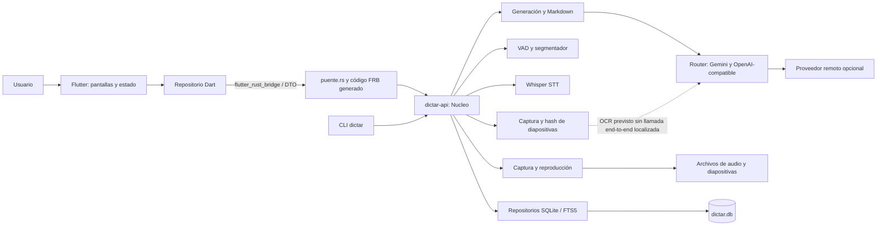
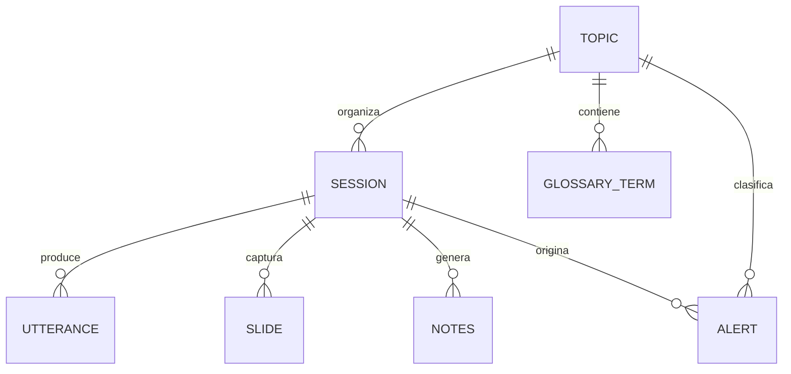

# Diagnóstico actual de dictar_ia

**Corte analizado:** 6 de octubre de 2026  
**Ubicación:** `D:\dev_v1\dictar_ia`  
**Alcance:** lectura del árbol de trabajo disponible, incluidos los cambios locales sin confirmar. No se ejecutaron pruebas ni se modificó código de producto.

## Alcance y conclusión

El código describe una aplicación local de escritorio y Android para grabar clases y reuniones, transcribir audio con Whisper y generar apuntes estructurados con proveedores de IA configurables. El sistema no es un único bloque: es un workspace Rust con una interfaz Flutter, un puente FFI generado y un CLI. La base de datos SQLite y el procesamiento permanecen en el dispositivo. (README.md:1-8, 87-98; Cargo.toml:1-14; `core/api/Cargo.toml`:6-10)

El recorrido de grabación y consulta está implementado en más de una capa, pero el README declara como pendientes el botón de importación y la búsqueda de la interfaz. También advierte que la captura real en Windows y Android no estaba comprobada en hardware. Estas afirmaciones describen el estado narrado en el README; esta revisión estática no ejecutó la aplicación ni verificó dispositivos. (README.md:189-205)

**Identificación del producto:** se toma `dictar_ia` y su propósito de README.md. Los campos de contexto del pedido venían como marcadores sin completar; por eso no se atribuye otro nombre, audiencia o prioridad al sistema.

## 1. Inventario

### Estructura observada

| Carpeta | Contenido y papel deducido |
|---|---|
| `app/` | Aplicación Flutter/Dart, pantallas, modelos de presentación, repositorio, puente generado y proyectos de plataforma Android/Linux/Windows. (`app/lib/`, `app/android/`, `app/linux/`, `app/windows/`) |
| `core/domain/` | Tipos de negocio serializables: sesiones, transcripciones, notas, alertas e identificadores. |
| `core/storage/` | SQLite, migraciones, sesiones, topics, transcripciones, notas, glosario y búsqueda FTS. |
| `core/audio-capture/` | Captura específica de SO, formato WAV, sincronización, remuestreo y reproducción. |
| `core/vad/` | Detección de actividad de voz y segmentación de audio. |
| `core/stt/` | Whisper, selección/descarga de modelos y limpieza de resultados. |
| `core/providers/` | Configuración, credenciales, enrutamiento y adaptadores de proveedores IA. |
| `core/notes/` | Preparación de contexto y renderizado de notas estructuradas a Markdown. |
| `core/screen-capture/` | Captura de pantalla y detección de cambios de diapositiva. |
| `core/api/` | Fachada que coordina módulos Rust y superficie traducida al puente Flutter. |
| `cli/` | Ejecutable `dictar` para grabar, transcribir, generar notas y consultar proveedores. |
| `config/` | Configuración por proveedores (`providers.toml`). |
| `packaging/` | Scripts de empaquetado, iconos, Inno Setup y configuración MSVC. |
| `docs/` | Descripción de arquitectura, stack, proveedores, roadmap y empaquetado. |
| `.github/workflows/` | Flujos de integración continua y publicación. |
| `_orquestacion/` | Protocolo y documentación interna de trabajo; incluye cambios locales sin confirmar. |

Inventario derivado de `rg --files` del árbol actual. `target/` y `dist/` existen, pero se tratan como salidas generadas, no como módulos fuente. El listado contiene 10 crates en el workspace: nueve bajo `core/` y `cli`. (Cargo.toml:1-14)

### Lenguajes, dependencias y versiones

| Tecnología | Evidencia de versión disponible | Uso |
|---|---|---|
| Rust | edición 2021; MSRV declarado 1.75; workspace 0.1.0. No se fijó versión exacta de `rustc` en manifiesto. (`Cargo.toml`:16-20) | Núcleo, CLI y bibliotecas. |
| Dart / Flutter | Dart `^3.12.2`; Flutter `>=3.44.0` en lock; app 1.0.0+1. (`app/pubspec.yaml`:19-22; `app/pubspec.lock`:409-410) | Interfaz multiplataforma. |
| `flutter_rust_bridge` | 2.12.0 en Dart y Rust. (`app/pubspec.yaml`:36-38; `core/api/Cargo.toml`:26) | Comunicación Flutter-Rust. |
| `rusqlite` | requisito 0.32; bloqueado a 0.32.1 en `Cargo.lock`. (`Cargo.toml`:35; `Cargo.lock`:2941-2943) | SQLite con `bundled` y `backup`; FTS5 se crea en SQL. |
| `whisper-rs` | requisito 0.14; bloqueado a 0.14.4. (`core/stt/Cargo.toml`:16; `Cargo.lock`:3963-3965) | STT local basado en whisper.cpp. |
| Tokio | requisito 1; lock 1.53.1. (`Cargo.toml`:26; `Cargo.lock`:3487-3489) | Tareas asíncronas y runtime. |
| Reqwest | requisito 0.12; lock 0.12.28, con rustls. (`Cargo.toml`:27-30; `Cargo.lock`:2865-2867) | Peticiones HTTP a proveedores. |
| `serde`, `serde_json`, `schemars` | requisitos 1, 1 y 0.8; `schemars` bloqueado 0.8.22. (`Cargo.toml`:22-24; `Cargo.lock`:3047-3050) | Serialización y esquemas JSON para salida IA. |
| Plugins directos Flutter | `cupertino_icons ^1.0.8`, `window_manager ^0.5.2`, `file_selector ^1.1.0`, `flutter_lints ^6.0.0`. (`app/pubspec.yaml`:36-50) | Iconos, ventana, selección de archivos y lint. |

Las versiones de `Cargo.lock` y `pubspec.lock` son las resoluciones presentes en el árbol local. Los requisitos con `^` o rangos de Cargo no significan una actualización a la última versión; no se consultaron registros externos.

### Configuración y entradas

| Archivo | Función |
|---|---|
| `Cargo.toml` y `Cargo.lock` | Workspace, requisitos comunes y versiones resueltas Rust. |
| `app/pubspec.yaml` y `app/pubspec.lock` | Paquete Flutter/Dart y dependencias. |
| `flutter_rust_bridge.yaml` | Define como entrada `core/api/puente` y salida generada en Rust/Dart. |
| `config/providers.toml` | Configuración de adaptadores IA. |
| `.env.example` | Plantilla de claves; `.env` está excluido por `.gitignore`. No se leyeron valores de `.env`. |
| `core/storage/src/migrations.rs` | Esquema SQLite versionado mediante `PRAGMA user_version`. |
| `.github/workflows/ci.yml`, `.github/workflows/release.yml` | Compilación, análisis, pruebas declaradas y empaquetado por plataforma. |
| `packaging/windows/inno_setup.iss`, `packaging/linux/*.sh`, `app/android/` | Instaladores y configuración específica por SO. |

Entradas confirmadas en código: `app/lib/main.dart:11` inicializa Flutter; `cli/src/main.rs` despacha subcomandos; `core/api/src/puente.rs:226` inicializa el singleton Rust; `app/lib/src/rust/` y `core/api/src/frb_generated.rs` son código generado. El mapeo de generación está en `flutter_rust_bridge.yaml`.

**Estado del repositorio:** `main` figura detrás de `origin/main` por un commit, con 27 archivos rastreados modificados y tres nuevos sin seguimiento. Hay modificaciones en UI, pipeline, WASAPI, STT, configuración de CI y documentación de orquestación. Este informe describe el árbol local actual; no permite afirmar que esos cambios estén en `origin/main` ni en una versión publicada. (`git status --short --branch`, `git diff --stat`, consultados durante el análisis.)

## 2. Funcionalidades deducidas

1. **Organizar por asignatura o cliente.** `Topic` distingue cursos y clientes; permite consultar/crear topics y asociar sesiones. ( `core/domain/src/session.rs`:23-24,105; `core/api/src/puente.rs`:239-270)
2. **Grabar audio.** El dominio diferencia micrófono, loopback de escritorio, micrófono móvil e importación. La pantalla de grabación inicia/detiene y muestra niveles, estado y eventos. (`core/domain/src/session.rs`:40-76; `app/lib/pantallas/grabacion.dart`:71-112,324-326)
3. **Transcribir.** Whisper procesa localmente y emite frases provisionales en vivo; el flujo final vuelve a transcribir y persiste el resultado definitivo. (`core/stt/src/whisper.rs`:1-49; `core/api/src/transcriptor.rs`; `core/api/src/proceso.rs`)
4. **Generar documentos según el tipo de reunión.** Hay plantillas para clase, reunión comercial y reunión de equipo, con tiempos asociados a afirmaciones. (`core/domain/src/notes.rs`:52,181,335)
5. **Capturar diapositivas y relacionarlas temporalmente con la sesión.** El núcleo expone selección de región, captura periódica y captura manual; `Slide` contempla marca temporal, hash y un campo OCR. La captura está cableada, pero no quedó acreditada una ruta OCR completa. (`core/api/src/grabacion.rs`:160-183,291-315; `core/api/src/puente.rs`:430-459,634; `core/domain/src/transcript.rs`:58-80)
6. **Consultar historial y reproducir grabaciones.** El puente permite listar sesiones, obtener transcripción/notas, reproducir, pausar, saltar y borrar. (`core/api/src/puente.rs`:273-318,541-581)
7. **Consultar pendientes/alertas y búsqueda de transcripciones.** El núcleo expone `listar_pendientes`, `descartar_aviso` y `buscar`; la migración configura FTS5. (`core/api/src/puente.rs`:321-350; `core/storage/src/migrations.rs`:163-193)
8. **Configurar proveedor y exportar notas.** El núcleo lista/probar proveedores, recibe claves, guarda preferencias y exporta Markdown. (`core/api/src/puente.rs`:380-428,472-538)
9. **Operar desde CLI.** El README lista `sesion`, `grabar`, `transcribir`, `notas` y `proveedores`. (`README.md`:156-169; `cli/src/main.rs`:1-110)

**Límite verificado en la UI:** Inicio enlaza explícitamente Importar y Búsqueda a `_avisar`, cuyo texto dice que están pendientes de conexión. Por tanto, la existencia de `leer_wav` o `buscar` en el núcleo no prueba que estos controles de interfaz funcionen. (`app/lib/pantallas/inicio.dart`:41-47,91-94; `core/api/src/puente.rs`:342-350)

## 3. Arquitectura actual

### Componentes y comunicación

El puente contiene una instancia global `OnceLock<Nucleo>` y funciones libres traducibles; la fachada posee la DB bajo `Mutex`, la grabación y el reproductor. La fachada ensambla storage, audio, STT, notas, proveedor y pantalla. (`core/api/src/puente.rs`:16-26,226-233; `core/api/src/lib.rs`:36-62)

### Estilo observado

**Se parece a un monolito modular en proceso con capas/adaptadores.** Hay separación por crates y por responsabilidades (dominio, almacenamiento, proveedores, infraestructura de audio/STT, API), pero se entrega como ejecutables y librería nativa integrados en la misma aplicación; no hay backend/servicio independiente indicado en el código. El CLI y Flutter reutilizan `dictar-api`. (`Cargo.toml`:1-14; `cli/Cargo.toml`:12-19; `core/api/Cargo.toml`:11-24)

**Dónde la separación pierde nitidez:**

- `dictar-api` coordina flujo, almacenamiento y recursos del SO dentro de `Nucleo`; opera como fachada amplia y contiene estado de vida de la app. (`core/api/src/lib.rs`:36-62,80-105)
- La capa Flutter declara una abstracción de repositorio, pero su implementación está acoplada a funciones estáticas generadas del puente; parte de la UI también pregunta por el tipo concreto `RepositorioRust`. (`app/lib/datos/repositorio.dart`; `app/lib/datos/repositorio_rust.dart`:70-85; `app/lib/pantallas/grabacion.dart`:235-253)
- El puente usa DTOs separados de las entidades de dominio. El código dice que esto es intencional para mantener tipos simples en FFI; existe conversión adicional en `puente.rs` y Dart, que eleva el número de lugares que deben cambiar juntos. (`core/api/src/puente.rs`:30-90; `app/lib/datos/repositorio_rust.dart`:101-180)
- La documentación de diseño incluye capacidades planeadas (por ejemplo, fallback PulseAudio/portal), que no se deben contar como implementadas sin correspondencia ejecutable en el módulo de captura. (`docs/01-arquitectura.md`; `core/audio-capture/src/lib.rs`)

## 4. Modelo de datos

### Diagrama lógico

El esquema relacional se declara en `core/storage/src/migrations.rs:49-151`; FTS5 y sus triggers se declaran en `:163-193`. Las claves foráneas borran en cascada frases, diapositivas, notas, alertas y glosario; borrar un topic conserva sesiones y pone `topic_id` en NULL. (`migrations.rs`:60-63,79-99,108-110,119-143; `sessions.rs`:254)

| Entidad | Datos relevantes | Lectura/escritura |
|---|---|---|
| `topic` | tipo curso/cliente, nombre, persona, período/color, consentimiento | `storage/topics.rs`; llamadas `Nucleo::topics/crear_topic`. |
| `session` | topic, tipo, título, inicio/fin, fuente, estado, ruta de audio, denoise | `storage/sessions.rs`; creación al iniciar grabación en `api/grabacion.rs`. |
| `utterance` | pista, hablante, intervalo ms, texto, confianza, final/revisión | `storage/transcript.rs`; provisional y final desde `api/transcriptor.rs`/`proceso.rs`. |
| `slide` | ruta, marca temporal, hash perceptual, texto OCR, pie | `storage/transcript.rs`; API captura y proceso. |
| `glossary_term` | topic, término/definición, origen y frecuencia | `storage/notes_store.rs`; consulta para el prompt de Whisper desde `api/lib.rs`. |
| `notes` | plantilla, clase rolling/final, secuencia, proveedor/modelo, JSON payload y coste | `storage/notes_store.rs`; proceso guarda notas desde `api/proceso.rs`. |
| `alert` | sesión/topic, clase, texto, fecha, marca temporal y descartado | `storage/notes_store.rs`; extracción y consulta de pendientes. |
| `utterance_fts` | índice virtual sobre texto definitivo | Trigger insert/update/delete y rebuild en migración 2. |

Los tipos de dominio están en `core/domain/src/session.rs`, `transcript.rs`, `notes.rs` y `alert.rs`; los cuerpos detallados de notas están serializados como `payload` en vez de tablas por cada campo. ( `core/domain/src/notes.rs`; `core/storage/src/notes_store.rs`:30-67)

## 5. Dos flujos principales de punta a punta

### Flujo A: grabar, transcribir en vivo y finalizar

1. `app/lib/pantallas/grabacion.dart:71-112` solicita permisos, crea o selecciona un topic y llama al repositorio para empezar.
2. `app/lib/datos/repositorio_rust.dart:194-211` transforma opciones a DTO y llama `rust.iniciarGrabacion`; el puente entra a `core/api/src/puente.rs:585-622`.
3. `core/api/src/grabacion.rs` crea una sesión (persistencia inicial mediante `crear_sesion`, línea 103) y arranca captura. `core/audio-capture` escribe por pista; `core/api/src/grabacion.rs` drena frames, los persiste antes de encolarlos al segmentador/transcriptor. (`core/api/src/grabacion.rs`, bucle de frames; `core/audio-capture/src/wav.rs`)
4. `core/api/src/transcriptor.rs` ejecuta Whisper vivo y emite eventos/frases; `RepositorioRust._sondear` recoge esos eventos y el estado de Flutter los presenta. (`core/api/src/transcriptor.rs`; `app/lib/datos/repositorio_rust.dart`:374-425; `app/lib/pantallas/grabacion.dart`)
5. Al detener, la UI invoca `detenerGrabacion`, retorna sin bloquear el vaciado de cola y conserva el id de sesión. (`app/lib/pantallas/grabacion.dart`:324-339; `repositorio_rust.dart`:214-225)
6. La acción de proceso llama `procesarSesion`; `core/api/src/proceso.rs` transcribe los WAV definitivos, guarda frases definitivas, genera notas/alertas/glosario y cambia el estado. Las escrituras pasan por `storage/transcript.rs` y `storage/notes_store.rs`; FTS indexa la transcripción final vía trigger. (`app/lib/datos/repositorio_rust.dart`:266-282; `core/api/src/puente.rs`:682-697; `core/api/src/proceso.rs`; `core/storage/src/transcript.rs`:47-118; `notes_store.rs`:30-67,99-135)

**Distinción:** pasos 1-6 están trazados estáticamente por llamadas y contratos del código; no se reprodujo una grabación real en esta revisión. Las capacidades reales de audio dependen del backend y del hardware.

### Flujo B: abrir sesión y leer/escuchar/buscar

1. `app/lib/pantallas/inicio.dart` carga topics y sesiones por `Repositorio`; el adaptador consulta `listar_topics/listar_sesiones`. (`inicio.dart`:19-35; `repositorio_rust.dart`:101-128)
2. Al seleccionar una sesión, la pantalla `sesion.dart` carga metadatos, notas y transcripción mediante métodos del repositorio. (`app/lib/pantallas/sesion.dart`:50-55; `repositorio_rust.dart`:124-158)
3. El adaptador invoca `obtener_notas` y `obtener_transcripcion` en el puente; `Nucleo` obtiene SQLite vía `Db`, `notes_markdown` representa payload como Markdown y `storage/transcript.rs` ordena frases por tiempo. (`core/api/src/puente.rs`:298-319; `core/api/src/lib.rs`:152-177; `core/storage/src/transcript.rs`:120-145)
4. Reproducción solicita al núcleo archivos de audio por id y posición; `Nucleo::reproducir` crea el reproductor desde el directorio de esa sesión y expone estado/pausa/salto. (`core/api/src/puente.rs`:541-574; `core/api/src/lib.rs`:280-310)
5. La búsqueda del núcleo usa FTS5 sobre `utterance_fts` y devuelve frases, pero el botón de búsqueda de Inicio actualmente solo muestra un aviso de pendiente. (`core/storage/src/transcript.rs`:147-175; `app/lib/pantallas/inicio.dart`:41-47,91-94)

**Distinción:** la lectura y reproducción se deducen de llamadas del código. La búsqueda está implementada en storage/API, pero no se considera un flujo funcional de usuario en UI hasta conectar su control.

## 6. Diagnóstico con evidencia

La gravedad estima impacto potencial, no frecuencia comprobada. Los hallazgos de cobertura se basan en código y metadatos; no se ejecutó un escáner de seguridad ni pruebas.

| Gravedad | Hallazgo | Evidencia y alcance |
|---|---|---|
| **Alta** | La base de datos y los archivos de audio pueden guardar datos personales sin cifrado de aplicación declarado. El feature SQLCipher existe, pero está apagado por defecto. | `core/storage/Cargo.toml:16-21` fija `default = []` y el feature separado `cifrado`; `README.md:78-80` declara explícitamente ausencia de cifrado en reposo. Afecta transcripciones, apuntes y grabaciones locales en caso de acceso al perfil/disco. |
| **Alta** | Captura Windows/Android no tiene validación física demostrada por este árbol; los backends de dispositivo son dependencias críticas para el caso de uso central. | README.md:3-7 y :199-201 indica que no se habían ejecutado en equipos reales. `core/audio-capture/src/wasapi_src.rs` y `aaudio_src.rs` implementan rutas de plataforma; esta revisión no conectó dispositivos. La existencia de CI que compila no demuestra captura audible correcta. |
| **Media** | Los botones de importar audio y buscar en Inicio no completan una operación: solo presentan un mensaje. | `app/lib/pantallas/inicio.dart:41-47,91-94`. Contraste: el núcleo sí publica `buscar` en `core/api/src/puente.rs:342-350`; esa función no está conectada al botón. |
| **Media** | Hay soporte de datos y configuración para OCR, pero no se encontró una ruta que invoque el proveedor OCR ni guarde el texto al capturar una diapositiva. | `core/domain/src/transcript.rs:58-80` modela `ocr_text`; `core/storage/src/transcript.rs:192-198` permite guardarlo; `core/providers/src/config.rs:94-112` configura tarea de visión. En las rutas de captura revisadas (`core/api/src/grabacion.rs:160-183,291-315`) se registra el archivo/hash, sin llamada al router OCR. El paso previsto en README no está completo de punta a punta. |
| **Media** | Al menos algunas acciones de la pantalla de sesión son placeholders (exportación/regeneración). | `app/lib/pantallas/sesion.dart:145` asigna callback vacío al botón con notas; `:283` hace lo mismo con «Regenerar». Esto limita acciones posteriores a la generación. |
| **Media** | Secretos pueden persistir en texto plano en `.env` como mecanismo de desarrollo o respaldo si no se usa el llavero. | `core/providers/src/secretos.rs:7-20,296-325,343-388` documenta la cadena de resolución/caída a `.env` y el riesgo de texto claro; `README.md:78-84` describe ese modo. El código actual **sí contiene integración con keyring**, así que la frase del README que dice que aún no existe está desactualizada. No se inspeccionaron los valores del `.env`. |
| **Media** | Los cambios locales sin confirmar impiden atribuir el comportamiento actual a la rama remota o al último release. | `git status` muestra modificaciones en `core/api`, `core/audio-capture`, `core/stt`, `app/lib` y workflows, más archivos nuevos. Ejemplos: `core/api/src/proceso.rs`, `app/lib/pantallas/grabacion.dart`, `core/audio-capture/src/reproductor_wasapi.rs` (nuevo). |
| **Media** | La superficie central concentra coordinación, estado global y bloqueo compartido de DB; el FFI y Dart repiten adaptaciones. Esto aumenta el acoplamiento de cambios de sesión/proceso. | `core/api/src/lib.rs:36-62` combina estado; `core/api/src/puente.rs:16-26` global; `app/lib/datos/repositorio_rust.dart:101-180` adapta varios DTO. La separación está documentada como intencional, por lo que es un costo de mantenimiento, no defecto demostrado por sí solo. |
| **Media** | La cobertura de pruebas no debe interpretarse como cobertura end-to-end de plataformas. Hay pruebas unitarias y workflows, pero se excluyen interacciones de hardware/dispositivos reales. | `README.md:110-124` cuenta 373 pruebas históricas y matiza que no corrió Rust en esa máquina; `ci.yml:71-81,99-153` define build/tests y cobertura Windows del crate audio. Sin ejecutar CI local ni hardware no confirmo estado verde actual. |
| **Baja** | La documentación pública y el código ya divergen: el README dice que keyring no está implementado, mientras `secretos.rs` contiene resolver/guardado por keyring. También la UI tiene más acciones pendientes que las dos listadas. | `README.md:78-84,189-197`; `core/providers/src/secretos.rs:246-288,296-388`; `app/lib/pantallas/sesion.dart:145,283`. |
| **Baja** | Existe maquinaria de build y distribución de plataformas con grados diferentes de validación; pueden confundirse “compila/empaqueta” y “funciona en una sesión real”. | `README.md:3-7,199-201`; `.github/workflows/ci.yml` define jobs Linux/Windows/Android; workflows prueban compilación y pruebas, pero no una clase real con equipos del usuario. |

### Código duplicado, acoplamientos y código aparentemente sin uso

- No afirmo que haya duplicación de lógica de negocio sin una comparación más exhaustiva. La duplicación visible más clara son los DTO entre dominio Rust y Dart, descrita como una decisión explícita del límite FFI. (`core/api/src/puente.rs:30-90`; `app/lib/modelos/dominio.dart`; `app/lib/datos/repositorio_rust.dart`)
- Los módulos que parecen “sin uso” a primera vista (audio, pantalla, CLI) tienen dependencias/call sites en `core/api` o `cli`; no encontré base suficiente para marcarlos como código muerto. `app/lib/pantallas/inicio.dart` sí contiene controles sin conexión; eso se clasifica como funcionalidad incompleta, no archivo sin uso.
- Hay pruebas bajo `app/test/` y `#[cfg(test)]` en Rust. No se afirma ausencia total de pruebas. La brecha identificable es la validación física de rutas de captura y el hecho de que los conteos del README son históricos frente a cambios locales posteriores.

## 7. Preguntas abiertas

1. ¿El objetivo operativo principal hoy es Linux, Windows o Android? README prioriza Linux, pero hay cambios recientes en WASAPI y CI Windows.
2. ¿El `.env` presente en la raíz es solo local de desarrollo o se distribuye/copia a equipos finales? No se inspeccionó su contenido.
3. ¿El comportamiento esperado de “importar audio” es abrir un archivo, crear una sesión asociada a topic y lanzar automáticamente procesamiento, o solo importar una grabación ya existente?
4. ¿La captura de pantalla debe grabar toda la pantalla, una región elegida o solo una ventana compartida? La API soporta configuración de región; falta aclarar la política esperada para reuniones sensibles.
5. ¿Qué datos se consideran conservables y por cuánto tiempo: WAV originales, texto provisional, transcripción final, OCR y prompts/respuestas de proveedor?
6. ¿Las funciones de regenerar/exportar en la pantalla de sesión deben quedar disponibles offline y con el proveedor/modelo original, o basta la salida actual en Markdown?
7. ¿Qué fuente se toma como referencia para validar lo “actual”: árbol local con cambios sin confirmar, `origin/main` o el último instalador publicado?

## Fuentes de código revisadas

README y documentación de diseño; manifiestos y locks Rust/Flutter; configuración del puente; módulos `domain`, `storage`, `providers`, `audio-capture`, `vad`, `stt`, `notes`, `screen-capture`, `api`; pantallas y repositorio Dart; CLI; workflows CI/release y manifiestos de empaquetado. La inspección fue estática. No se modificaron archivos de producto ni se ejecutaron pruebas.
