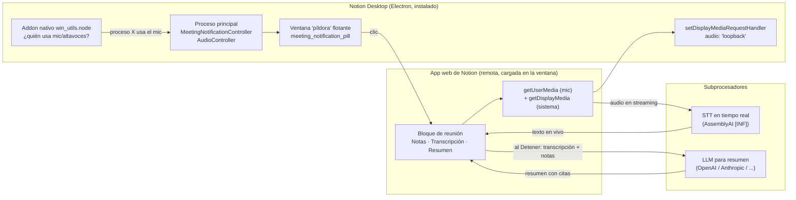

# Investigación: cómo funcionan las reuniones de Notion y qué le falta a dictar_ia

**Proyecto:** dictar_ia
**Fecha:** 12 de octubre de 2026
**Sustituye en parte a:** [investigacion-notion-transcripcion-local-2026-10-06.md](investigacion-notion-transcripcion-local-2026-10-06.md). La parte sobre Notion se amplía. La parte sobre dictar_ia se rehace, porque el 8 de octubre cambió mucho: Sherpa, Vosk, acuerdo de hipótesis y cierre rápido.
**Estado:** investigación. No se modificó código de producto.

---

## 0. Resumen ejecutivo

**Cómo funciona Notion por dentro.** La app de escritorio es un cascarón Electron fino:

- Detecta reuniones observando qué proceso usa el micrófono, mediante un addon nativo propio.
- Captura el audio del sistema con la API de Chromium `getDisplayMedia({audio: "loopback"})`, que en Windows es loopback de WASAPI.
- Manda el audio en vivo a proveedores en la nube: AssemblyAI es el único especialista en voz de su lista de subprocesadores.
- Al pulsar «Detener» genera el resumen con un LLM.

La lógica de transcripción y resumen no viaja en el instalador: vive en la web de Notion.

**Dónde está dictar_ia.** Tiene ya el mismo núcleo de producto, y en algunos puntos mejor: todo local, dos pistas separadas desde el origen, español real en vivo y sin cuota de minutos. Lo que le falta para sentirse como Notion no es el motor sino lo que lo rodea, en tres frentes:

1. **Calidad comprobada en una clase real de Windows.** Es el bloqueo actual (eco, frases repetidas, apuntes pobres) y sin él lo demás no importa.
2. **Flujo de usuario alrededor de la grabación:**
   - notas propias durante la sesión que alimenten el resumen;
   - instrucciones personalizadas;
   - regenerar el resumen;
   - reanudar una sesión;
   - aviso de «muy poco audio para resumir».
3. **Lo que pasa después:**
   - búsqueda en la interfaz, cuyo backend ya existe;
   - preguntar a la IA sobre las clases;
   - importar audio desde la interfaz;
   - detección de reunión y calendario.

En la [sección 6](#6-qué-nos-hace-falta-priorizado) está la lista priorizada.

---

## 1. Método y calidad de la evidencia

| Fuente | Qué aporta | Marca |
|---|---|---|
| Centro de ayuda, notas de versión, página de producto y API de Notion | Comportamiento oficial | **[DOC]** |
| Análisis estático de **Notion Desktop 7.21.0 para Windows** con REA (`rea analyze-javascript-application`) y lectura de archivos concretos del `app.asar` | Arquitectura real del cliente: ventanas, canales IPC, addon nativo, método de captura | **[ASAR]** |
| Reseñas de terceros (tl;dv, publicada el 09/10/2026; TechCrunch; Hacker News). tl;dv es competidor de Notion | Comportamiento observado y precisión | **[TERCERO]** |
| Deducción propia | Lo que no está documentado | **[INF]** |
| Código de dictar_ia en el árbol local del 12/10, con cambios sin commitear | Estado propio | rutas `archivo:línea` |

**Límites del análisis de Notion:**

- Solo se leyó el instalador, sin ejecutar nada de Notion y sin capturar su tráfico de red.
- La interfaz principal de Notion se carga desde `notion.so` (ventana `client_placeholder`), así que el código que transcribe, muestra la transcripción y resume **no está en el ASAR** y no se analizó.
- Se describe la arquitectura (nombres de módulos, canales y llamadas de sistema) y no se copió código.
- Los términos de Notion restringen la ingeniería inversa: este documento es para entender el diseño, no para reutilizar su implementación.

---

## 2. Arquitectura de Notion AI Meeting Notes

### 2.1 Detección de reuniones [ASAR + DOC]

- El addon `@notionhq/desktop-native` carga `win_utils.node` en Windows y `mac_utils.node` en macOS. Expone:
  - `getProcessesAccessingMicrophoneWithResult` y una variante con *debounce* (filtrado de rebotes);
  - `getProcessesAccessingSpeakersWithResult`;
  - `getRunningInputAudioProcesses`;
  - en Mac, `startMonitoringMic`.
- **La detección no escucha el audio.** Pregunta al sistema qué proceso tiene abierto el micrófono o los altavoces. Empleados de Notion lo confirmaron en Hacker News: «mic encendido + el proceso se llama zoom/google/etc.», en local y sin monitorizar la red.
- Si se reconoce una reunión, el `MeetingNotificationController` abre una ventana flotante («píldora», 480×136 px en modo aviso y 184×184 en modo compacto) con zonas arrastrables y clicables. Su texto es del tipo «¿Transcribir esta reunión?».
- La detección es *opt-out*, en Ajustes → Notificaciones. Hay canal IPC `notion:disable-meeting-notifications`.
- **Nunca empieza a grabar sola** [DOC + TERCERO]: si ignoras el aviso, no se graba nada.

### 2.2 Calendario y «Próximos eventos» [ASAR + DOC]

- El proceso principal programa avisos para eventos del calendario (canales `notion:schedule-calendar-tick` y `notion:calendar-tick`), con temporizadores por pestaña.
- «Unirse y transcribir» aparece 15 minutos antes de cada evento con videollamada.
- La nota queda vinculada al evento: título, asistentes y fecha. Con eso se pueden nombrar los hablantes y compartir automáticamente con los participantes.
- Tiene atajo global para crear una nota de reunión desde la búsqueda rápida (`notion:quick-search-create-meeting-notes`).

### 2.3 Captura de audio [ASAR + DOC]

- El proceso principal intercepta las peticiones de captura de pantalla de la web con `setDisplayMediaRequestHandler` y devuelve `audio: "loopback"`:
  - en Windows, Chromium lo implementa con loopback de WASAPI, la misma técnica que `wasapi_src.rs`;
  - en macOS usa Core Audio Tap (audio solo) o, como respaldo, ScreenCaptureKit (pantalla + audio).
- El micrófono va por `getUserMedia`. Ambas fuentes llegan a la web como `MediaStream`. [INF] Por la etiqueta de hablante «según qué micrófono está activo» (versión 3.6), Notion conserva las dos fuentes separadas al menos para atribuir hablante.
- Solo admite **una transcripción activa a la vez** (`notion:enforce-single-active-transcription`).
- Escucha suspensión y reanudación del sistema (`powerMonitor`).
- Tiene ventana de diagnóstico de altavoces y micrófono (`speaker_and_microphone_status`).
- Por plataforma:
  - en navegador solo capta el micrófono;
  - en móvil, solo el micrófono, también en segundo plano;
  - en VDI/RDP hay un proxy nativo (`RemoteMeetingNotesProxy`) que trae el audio local.

### 2.4 Transcripción en vivo [DOC + TERCERO]

- El audio va en streaming a subprocesadores. La lista para esta función es OpenAI, Anthropic, Fireworks, Baseten, X.AI y AssemblyAI. [INF] AssemblyAI hace el STT y los demás son LLMs.
- La transcripción se ve en vivo, con un retraso de «una o dos frases», y cada cambio de hablante abre línea nueva.
- Idiomas: 16 oficiales, incluido español, más `auto`. La API admite algunos más.
- **Hablantes:**
  - solo en escritorio y solo en inglés;
  - se basan en qué micrófono está activo (local frente a remoto), no en diarización acústica;
  - en reuniones de grupo fallan [TERCERO].
- No funciona sin conexión.
- Precisión medida por tl;dv: 10 % de WER (tasa de error por palabra) en inglés, con 4 hablantes.

### 2.5 Resumen [DOC]

- **Cuándo:** al pulsar «Detener» se genera automáticamente. Requiere al menos unos 300 caracteres transcritos (≈1 min). Se puede «Reanudar transcripción» y «Reintentar resumen».
- **Entrada:** la transcripción **más las notas que el usuario escribió** antes o durante la reunión. El bloque tiene tres hijos: notas, transcripción y resumen.
- **Formato:**
  - «Auto» adapta la estructura al tipo de reunión;
  - hay **instrucciones personalizadas** guardadas como página plantilla, compartibles y marcables como predeterminadas, que solo afectan a grabaciones nuevas o reintentadas;
  - desde abril de 2026 incluye contexto del espacio de trabajo.
- **Citas:** cada punto del resumen enlaza con la línea exacta de la transcripción (versión 3.1).
- **Puntos clave y tareas:** sí, aunque tl;dv las vio sin responsable y con alguna frase inventada.

### 2.6 Después de la reunión [DOC]

- Pestaña «Reuniones» con lista, filtros, orden y búsqueda.
- Notion AI responde preguntas sobre reuniones pasadas con enlaces a la discusión original.
- Las notas se comparten con los participantes del evento.
- Base de datos de reuniones, API, MCP y agentes que se disparan al terminar un resumen (enviar a Slack, crear tickets…).
- Subir audio (AAC, M4A, MP3, WAV) desde julio de 2026.

### 2.7 Límites y privacidad [DOC]

- Plan Business o superior. Los gratuitos tienen una prueba de minutos: es el mensaje «Ya usaste todos los minutos gratuitos» de la captura.
- Tope de 10 h por usuario y día.
- **Audio:**
  - va a la nube y los subprocesadores no lo guardan;
  - copia local temporal de hasta 24 h;
  - si el procesamiento falla, se conserva hasta 3 días;
  - guardar audio en el equipo es opcional y está apagado por defecto (como máximo las 10 últimas grabaciones).
- **Consentimiento:** pulsar «Iniciar» equivale a declarar que tienes consentimiento. Hay mensaje para pegar en el chat o un aviso de voz, y desde marzo de 2026 un modo de consentimiento obligatorio.

---

## 3. Qué hace hoy dictar_ia en las mismas funciones

| Función | Notion | dictar_ia hoy | Evidencia |
|---|---|---|---|
| Captura micrófono + sistema en escritorio | ✅ Loopback Chromium/WASAPI | ✅ WASAPI propio (Windows) y PipeWire (Linux); dos WAV separados | `core/audio-capture/src/wasapi_src.rs`, `core/api/src/grabacion.rs` |
| Captura en móvil | Solo micrófono, también en segundo plano | Escrita, **nunca ejecutada en un teléfono** | `core/audio-capture/src/aaudio_src.rs` |
| Detección automática de reunión | ✅ Por proceso que usa el micrófono | ❌ | — |
| Calendario y próximos eventos | ✅ | ❌ | — |
| Contexto antes de empezar | Notas y agenda en el bloque | 🟡 Asignatura, persona y tipo; `--contexto` libre solo en el CLI | `app/lib/pantallas/grabacion.dart:181-205` |
| **Notas propias durante la sesión** | ✅ Alimentan el resumen | ❌ | — |
| Transcripción en vivo | ✅ En la nube, 1–2 frases de retraso | ✅ Local: Sherpa (español), Vosk (inglés), Whisper Tiny (automático). Primera parcial ≈2,8 s, sin duplicados en el replay | `core/api/src/transcriptor.rs`, `core/stt/src/sherpa.rs`, [plan Windows](plan-correccion-calidad-windows.md) |
| Borrador frente a texto confirmado | Implícito | ✅ Acuerdo de dos hipótesis, borrador diferenciado en la UI | `core/stt/src/acuerdo.rs`, `app/lib/modelos/transcripcion_en_vivo.dart` |
| Etiqueta de hablante | Por micrófono activo; solo inglés | ✅ Por pista Yo/Sistema en **cualquier idioma**. Mismo principio, pero con pistas separadas desde el origen | `core/domain/src/transcript.rs` |
| Diarización dentro de la pista del sistema | ❌ (falla en grupo) | ❌ | — |
| Eco del altavoz en el micrófono | No documentado | ⚠️ **Detectado en 2 de 3 clases** (correlación ≥0,7). Solo se atenúa al reproducir | [plan Windows §Retorno acústico](plan-correccion-calidad-windows.md) |
| Pausar y reanudar la grabación | ✅ «Reanudar transcripción» | ❌ (solo se pausa el reproductor) | `core/api/src/puente.rs:572` |
| Resumen automático al detener | ✅ | ✅ Detener encadena el procesado | `app/lib/pantallas/grabacion.dart:318-345` |
| Mínimo de audio para resumir | ✅ ≈300 caracteres, con aviso | ❌ Sin umbral ni aviso de «transcripción insuficiente» | — |
| Plantillas de resumen | Auto + reuniones de ventas, standup y equipo | ✅ Clase, comercial y equipo | `core/domain/src/notes.rs:18-30` |
| **Instrucciones personalizadas** | ✅ | ❌ | — |
| Regenerar resumen | ✅ «Reintentar resumen» | ❌ Botón sin acción | `app/lib/pantallas/sesion.dart:283` |
| Citas que llevan al momento exacto | ✅ Enlace a la línea de transcripción | ✅ Enlace al **audio** (`ts_ms`) y reproducción en ese punto. Mejor que Notion en esto | `app/lib/pantallas/sesion.dart:103-107` |
| Tareas con responsable | Sí, a menudo sin responsable | ✅ Responsable opcional, sin inventarlo | `core/domain/src/notes.rs:347-349` |
| Resumen rodante durante la sesión | No | 🟡 Existe (`NotesGenerator::rodante`) pero **no está conectado** | `core/notes/src/lib.rs` |
| Lista de reuniones | ✅ Pestaña Reuniones | ✅ Inicio por asignatura | `app/lib/pantallas/inicio.dart` |
| **Búsqueda** | ✅ | 🟡 FTS5 en el núcleo; **botón sin conectar** | `app/lib/pantallas/inicio.dart:47` |
| **Preguntar a la IA sobre clases pasadas** | ✅ | ❌ (HU-08) | `docs/06-historias-de-usuario.md` |
| **Importar audio** | ✅ AAC/M4A/MP3/WAV | 🟡 Solo WAV y solo por CLI; botón sin conectar | `app/lib/pantallas/inicio.dart:42` |
| Exportar | Página Notion, API, MCP | ✅ Markdown; PDF pendiente (HU-09) | `core/api/src/puente.rs` |
| Glosario que aprende por asignatura | ❌ | ✅ | README §5 |
| Capturar diapositivas ligadas al tiempo | ❌ (solo audio) | ✅ Manual; OCR sin conectar | `core/api/src/grabacion.rs` |
| Sin conexión y privacidad | ❌ Nube obligatoria | ✅ Todo local; solo texto al LLM, o nada si se usa Ollama | README §3, §8 |
| Coste | Business a 20 $/mes y prueba con cuota de minutos | ≈$0,002 por sesión con DeepSeek, o $0 con Ollama | README |
| Consentimiento | Declaración, mensaje para el chat, aviso de voz y modo obligatorio | 🟡 `consent_ack` por asignatura de cliente | `core/domain/src/session.rs:40-43,116` |
| Píldora flotante mientras graba | ✅ | ✅ La ventana se encoge y queda encima | `app/lib/ventana.dart` |
| Diagnóstico de dispositivos de audio | ✅ Ventana dedicada | 🟡 Medidores de nivel y `dictar metricas` en el CLI | `cli/src/metricas.rs` |
| Una sola grabación activa | ✅ | ✅ Por diseño del `Nucleo` | `core/api/src/lib.rs` |
| Suspensión y reanudación del equipo | ✅ Escucha `powerMonitor` | ❌ Sin tratamiento explícito | — |

---

## 4. Lo que dictar_ia ya hace mejor que Notion

Conviene no perderlo de vista al priorizar:

1. **Funciona sin conexión y sin cuota de minutos.** La captura de pantalla del usuario es justo el límite de Notion: «Ya usaste todos los minutos gratuitos».
2. **Español con etiquetas Yo/Sistema.** El etiquetado de Notion solo funciona en inglés.
3. **Las citas llevan al segundo exacto del audio**, no solo a la línea de transcripción.
4. **Diapositivas ligadas al tiempo y glosario por asignatura.** Notion no tiene nada pensado para clases.
5. **Tareas sin responsables inventados.** Es una decisión explícita del esquema.

---

## 5. Lecciones de diseño que conviene copiar (el diseño, no el código)

1. **Detección por proceso, no por audio.** Preguntar al sistema qué proceso usa el micrófono es barato, privado y fiable.
   - En Windows está la clave del registro `CapabilityAccessManager\ConsentStore\microphone` (las entradas con `LastUsedTimeStop = 0` están activas).
   - En Linux, PipeWire informa de los nodos de captura activos.
   - Con una lista de procesos conocidos (Zoom, Teams, navegador con Meet) basta para avisar «¿Grabar esta clase?».
2. **Nunca grabar sin un clic.** Notion avisa y espera. Para clases y reuniones con clientes es lo correcto.
3. **Las notas del usuario son una tercera entrada del resumen.** Es barato (un campo de texto con marcas de tiempo) y mejora mucho el resultado: lo que el usuario apunta suele ser lo que le importa.
4. **Umbral mínimo y reintento.** No resumir 20 segundos de audio. Decir por qué no hay resumen y ofrecer «Reintentar».
5. **Instrucciones como plantilla editable,** separadas del tipo de sesión y guardadas por asignatura.
6. **Diagnóstico de audio visible para el usuario.** Notion tiene una ventana «Estado de altavoces y micrófono». dictar_ia tiene `dictar metricas` solo en el CLI y es justo lo que hace falta para el eco.

---

## 6. Qué nos hace falta, priorizado

### P0 · Sin esto lo demás no sirve (calidad en Windows)

| # | Qué | Por qué | Cómo, a grandes rasgos |
|---|---|---|---|
| 1 | **Validar el `.exe` actual en una clase real** con navegador y ambas pistas | Nada de lo del 8/10 se probó instalado en un perfil limpio. Es el criterio de aceptación de HU-14 a HU-16 | Instalar `dist/dictar_ia-0.1.0-windows-setup.exe`, grabar 20–30 min con auriculares y otros 20–30 con altavoces, y guardar los WAV como corpus |
| 2 | **Resolver el eco en la pista del micrófono** | 2 de 3 clases tienen retorno acústico ≥0,7. Hoy solo se atenúa al reproducir, no en la transcripción ni en el resumen | (a) Recomendar auriculares en la UI cuando se detecte retorno. (b) Cancelación de eco usando `system.wav` como referencia, por ejemplo con WebRTC AEC3 vía `webrtc-audio-processing`. (c) Modo «solo profesor» que ignore el micrófono en clases en video |
| 3 | **Referencia humana y WER** | Sin medir no se sabe si mejora ni si los apuntes son buenos | Transcribir a mano 10 min de una clase y calcular WER por pista, en vivo y final |
| 4 | **Pasada final asequible** | Turbo no termina con un núcleo y Small tarda 2,56× la duración de la clase. En una PC modesta, procesar una clase de 1 h puede llevar horas | Quedarse con el cierre rápido (no repetir la pasada si el texto en vivo cubre la sesión). Si hace falta pasada final, usar Small o Medium cuantizado y no Turbo por defecto (hoy `core/api/src/puente.rs:707` lo fija) |
| 5 | **Arreglar la prueba de Flutter que falla** | `grabacion_test.dart` espera «Área de la diapositiva», que se quitó con la captura automática | Actualizar la prueba a la captura manual |
| 6 | **Commitear el trabajo de octubre** | 72 archivos sin commitear; el riesgo de perderlo es real | Una rama por tema: Sherpa/Vosk, WASAPI y reloj, reproductor WASAPI, métricas |

### P1 · Igualar la experiencia de Notion (alto impacto, coste bajo o medio)

| # | Qué | Equivalente en Notion | Notas |
|---|---|---|---|
| 7 | **Notas propias durante la sesión** que se envían al resumen | Bloque «Notas» | Campo de texto en la píldora o pantalla de grabación. Cada línea guarda `ts_ms`. Nueva tabla `user_note`, y un hueco más en el prompt de `core/notes/src/prompts.rs` |
| 8 | **Conectar Buscar** | Búsqueda en Reuniones | El backend FTS5 existe. Falta `session_id` en `FraseDto` (T-2), regenerar el puente y la pantalla de resultados que salta al momento |
| 9 | **Conectar Importar audio** | «Subir audio» | Selector de archivo, crear sesión `Imported` y procesar. Ampliar más allá de WAV con `symphonia` (MP3, M4A, AAC). Es HU-03 |
| 10 | **Regenerar resumen e instrucciones personalizadas** | «Reintentar resumen» e «Instrucciones» | Conectar `sesion.dart:283`. Instrucciones guardadas por asignatura (topic) que se añaden al prompt |
| 11 | **Umbral mínimo y aviso** | Mínimo de 300 caracteres | Si la transcripción tiene menos de ≈300 caracteres o menos de 1 min, no llamar al LLM y explicar por qué |
| 12 | **Pausar y reanudar la grabación** | «Reanudar transcripción» | Pausar la captura sin cerrar la sesión; reanudar sobre los mismos WAV con un hueco marcado. También sirve para suspensión y reanudación del equipo |
| 13 | **Diagnóstico de audio en la interfaz** | «Estado de altavoces y micrófono» | Llevar `dictar metricas` a la UI: niveles, recorte, silencio y **retorno acústico**, con recomendación |

### P2 · Lo que sigue (más trabajo o menos urgente)

| # | Qué | Equivalente en Notion | Notas |
|---|---|---|---|
| 14 | **Preguntar a la IA sobre clases pasadas** | Notion AI Q&A con enlaces | HU-08. Empezar sin vectores: FTS5 recupera fragmentos, el LLM responde y cita `ts_ms`. `sqlite-vec` solo si FTS5 no basta |
| 15 | **Detección de reunión** | Píldora «¿Transcribir?» | Ver §5.1. Opcional, con opción de desactivarla y sin grabar nunca sola |
| 16 | **Calendario** | Próximos eventos y «Unirse y transcribir» | Importar `.ics` o Google Calendar para pre-rellenar asignatura y hora. Para clases con horario fijo basta un horario semanal por asignatura, sin integración externa |
| 17 | **Resumen rodante en vivo** | No existe en Notion | Ya está escrito (`NotesGenerator::rodante`). Sería una ventaja propia: «lo que va de clase» cada 10 min. Solo después del P0 |
| 18 | **OCR de diapositivas al glosario** | No existe | Conectar el router de visión al capturar diapositivas |
| 19 | **Diarización dentro de la pista del sistema** | Notion tampoco | Útil en reuniones de equipo con varias voces remotas; en clases con un solo profesor no hace falta. Candidato: la diarización de sherpa-onnx (el proyecto ya usa sherpa-onnx para STT; habría que comprobar que el crate expone diarización) |
| 20 | **Consentimiento** | Mensaje para el chat y aviso de voz | Para reuniones con clientes: botón «Copiar aviso de grabación» al empezar |
| 21 | **Cifrado en reposo** (HU-06) y **firma del `.exe`** (T-17) | Notion lo resuelve en la nube | Necesarios para distribuir a terceros |
| 22 | **Captura en Android en un teléfono real** | Móvil con segundo plano | HU-02, nunca ejecutada |

---

## 7. Nuevas HU propuestas

Para añadir a [06-historias-de-usuario.md](06-historias-de-usuario.md) si el PO está de acuerdo. HU-14 a HU-18 ya existen en el [plan de Windows](plan-correccion-calidad-windows.md).

- **HU-19 · Apuntar mis propias notas durante la clase** y que el resumen las use. Criterio: una nota escrita en el minuto 12 aparece en los apuntes con su enlace al minuto 12.
- **HU-20 · Regenerar los apuntes con mis instrucciones.** Criterio: con la instrucción «solo fórmulas y avisos de examen», el resultado lo respeta y reemplaza el anterior sin duplicar.
- **HU-21 · Pausar y reanudar una grabación.** Criterio: pausar 2 min y reanudar produce una sola sesión cuya línea de tiempo marca el hueco; la transcripción no se desfasa.
- **HU-22 · Saber por qué no hay apuntes.** Criterio: una sesión de menos de 1 min o con transcripción insuficiente muestra el motivo y no llama al proveedor.
- **HU-23 · Que la app me avise si hay eco o mal audio.** Criterio: con altavoces y micrófono abiertos, la app detecta el retorno durante la sesión y recomienda auriculares o el modo «solo profesor».
- **HU-24 · Que la app detecte que empezó una clase.** Opcional. Criterio: al abrir Zoom, Teams o Meet aparece un aviso; sin clic no se graba nada.

---

## 8. Preguntas para el PO

1. ¿Qué es primero: la calidad en Windows (P0) o las funciones de experiencia (P1)? La recomendación es P0, porque sin audio y transcripción fiables las funciones nuevas amplifican un resultado malo.
2. Para clases en video, ¿se acepta un modo «solo profesor» que descarte el micrófono, a cambio de eliminar el eco de raíz?
3. ¿La detección automática de reuniones interesa, o basta un horario semanal por asignatura?
4. ¿Preguntar a la IA sobre clases pasadas debe funcionar con Ollama sin conexión, o puede depender del proveedor configurado?

---

## 9. Fuentes

- Notion — [Take AI Meeting Notes](https://www.notion.com/help/ai-meeting-notes) ([ES](https://www.notion.com/es/help/ai-meeting-notes)), [Add-on de Google Meet](https://www.notion.com/help/install-the-notion-meetings-add-on), [Guía de memoria de reuniones](https://www.notion.com/help/guides/preserve-perfect-meeting-memory-with-ai-meeting-notes), [Seguridad de Notion AI](https://www.notion.com/help/notion-ai-security-practices), [Precios](https://www.notion.com/pricing), [API create meeting note](https://developers.notion.com/reference/create-meeting-note).
- Notas de versión de Notion — [2025-05-13](https://www.notion.com/releases/2025-05-13), [2025-11-17](https://www.notion.com/releases/2025-11-17), [2026-01-20](https://www.notion.com/releases/2026-01-20), [2026-03-12](https://www.notion.com/releases/2026-03-12), [2026-03-18](https://www.notion.com/releases/2026-03-18), [2026-04-14](https://www.notion.com/releases/2026-04-14), [2026-07-01](https://www.notion.com/releases/2026-07-01), [2026-07-31](https://www.notion.com/releases/2026-07-31), [2026-09-15](https://www.notion.com/releases/2026-09-15).
- Terceros — [tl;dv, reseña del 09/10/2026](https://tldv.io/blog/notion-ai-meeting-notes-review/) (competidor), [TechCrunch, 13/05/2025](https://techcrunch.com/2025/05/13/notion-takes-on-ai-notetakers-like-granola-with-its-own-transcription-feature), [Hacker News 44594790](https://news.ycombinator.com/item?id=44594790).
- Análisis estático propio — Notion Desktop 7.21.0 (Windows), `app.asar` SHA-256 `1819efcd5039bed17f437d70446cfce109fb1a9758e934a0aa9086d7053e4700`. Archivos leídos:
  - `node_modules/@notionhq/desktop-native/module.js`;
  - `.webpack/main/index.js`, buscando `setDisplayMediaRequestHandler`, `MeetingNotificationController` y los canales `notion:*`;
  - `.webpack/renderer/speaker_and_microphone_status/preload.js`.
- Estado de dictar_ia — [plan-correccion-calidad-windows.md](plan-correccion-calidad-windows.md), [diagnostico-as-is-2026-10-06.md](diagnostico-as-is-2026-10-06.md) y las rutas citadas en §3.
